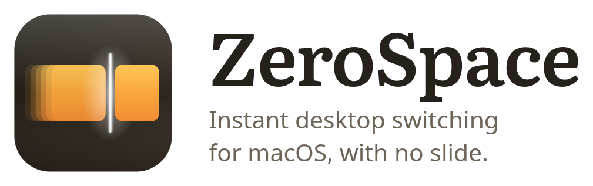
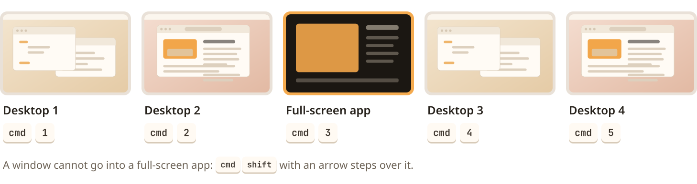

<p align="center">
  <picture>
    <source media="(prefers-color-scheme: dark)" srcset="docs/zerospace-header-dark.png">
    
  </picture>
</p>

<p align="center">
A small Rust app for macOS 27 that switches desktops with no animation at all,
with SIP left on.
</p>

<p align="center">
  <a href="https://crazyboycjr.github.io/zerospace/">Homepage</a> ·
  <a href="#keys">Keys</a> ·
  <a href="#how-it-works">How it works</a> ·
  <a href="#install">Install</a> ·
  <a href="#scripting">Scripting</a> ·
  <a href="#limits">Limits</a> ·
  <a href="CHANGELOG.md">Changes</a>
</p>

<picture>
  <source media="(max-width: 600px) and (prefers-color-scheme: dark)" srcset="docs/readme-switch-tall-dark.svg">
  <source media="(max-width: 600px)" srcset="docs/readme-switch-tall-light.svg">
  <source media="(prefers-color-scheme: dark)" srcset="docs/readme-switch-dark.svg">
  
</picture>

## Why I created this

I spend most of my day on Linux with xmonad, where switching workspaces is
instant: press a key and the other desktop is simply there. On the Mac every
switch slides, and macOS has no setting to stop it; Reduce Motion only trades
the slide for a fade. [TotalSpaces](https://totalspaces.binaryage.com/) used to
fix exactly this, and I missed it once it stopped keeping up with macOS.
[yabai](https://github.com/koekeishiya/yabai) with
[skhd](https://github.com/koekeishiya/skhd) can get close, but its instant
switching needs SIP partly turned off and a scripting addition loaded into the
Dock, and even then it never felt as immediate as I wanted. I wanted one small
app that does this one thing.

It turned out that macOS 27 will switch desktops instantly for any app with
Accessibility access, through private operations in its window server, with SIP
left on. So I built ZeroSpace around them: cmd+1 to cmd+5 jump straight to a
desktop, and two more shortcuts throw the focused window to another desktop,
staying put or following it. I designed and wrote it with an AI coding agent,
Claude; most of the work was finding the right private operations, not writing
the code.

If the slide bothers you too, read on. If you want tiling or a full window
manager, yabai, [AeroSpace](https://github.com/nikitabobko/AeroSpace),
[Amethyst](https://ianyh.com/amethyst/) and newer ones such as
[OmniWM](https://github.com/BarutSRB/OmniWM),
[HyprSpace](https://github.com/BarutSRB/HyprSpace) and
[HyprMac](https://github.com/zacharytgray/HyprMac) do far more.

## What it is

ZeroSpace runs in the background with no Dock icon, takes a few shortcuts, and
asks the window server to switch desktops and move windows for it. There is no
slide and no fade, not even a quick one.

- **No animation.** The window server makes the switch itself, so there is
  nothing to animate. The desktop's number flashes in the middle of the screen
  for half a second, so you know where you landed.
- **Windows come along.** Carry the focused window one desktop over and follow
  it.
- **SIP stays on.** There is no scripting addition, nothing is loaded into the
  Dock, and nothing in macOS is changed; ZeroSpace needs only Accessibility
  access.
- **Small and quiet.** It is about 1,000 lines of Rust with no dependencies. Its
  shortcuts are Carbon hot keys, so no event tap ever sits between you and your
  typing.

## Keys

<kbd>cmd</kbd> <kbd>1</kbd> to <kbd>cmd</kbd> <kbd>5</kbd> jump straight to desktop 1 to 5,
and its number flashes in the middle of the screen for half a second.

<kbd>cmd</kbd> <kbd>shift</kbd> <kbd>←</kbd> and <kbd>→</kbd> carry the focused window one
desktop over and follow it.

Desktops are numbered by their place in the Mission Control bar of the display
under the pointer, full-screen apps included, so cmd+3 always reaches whatever
sits third. A window cannot go into a full-screen app, so carrying a window
steps over it.

<picture>
  <source media="(max-width: 600px) and (prefers-color-scheme: dark)" srcset="docs/readme-slots-tall-dark.svg">
  <source media="(max-width: 600px)" srcset="docs/readme-slots-tall-light.svg">
  <source media="(prefers-color-scheme: dark)" srcset="docs/readme-slots-dark.svg">
  
</picture>

Once a switch has landed, the frontmost window on the new desktop gets the
keyboard, as macOS would give it, and an empty desktop gives it to Finder.

While ZeroSpace runs, the app in front no longer gets these shortcuts: a
browser's cmd+1 for its first tab, or cmd+shift+← to select to the start of a
line. macOS's own shortcuts come first, though: its Switch to Desktop shortcuts
on cmd+1 to cmd+5 keep those keys from ZeroSpace (see Install). cmd+shift with a
number is left alone, so the screenshot shortcuts on cmd+shift+3, 4 and 5 keep
working.

## How it works

macOS has no setting to turn the switch animation off, and the usual ways around
it either need SIP partly disabled, as yabai's scripting addition does, or play
the slide quickly, which is still a slide. ZeroSpace asks the window server,
SkyLight, to make the switch itself, through its private "bridged" operations,
each sent with `performWithWMBridgeDelegate`:

1. `SLSBridgedShowSpacesOperation` shows the desktop you asked for,
2. `SLSBridgedHideSpacesOperation` hides the display's other desktops, and
3. `SLSBridgedManagedDisplaySetCurrentSpaceOperation` makes it the display's
   current desktop.

A fourth, `SLSBridgedMoveWindowsToManagedSpaceOperation`, moves a window. macOS
27 accepts these from any app that has Accessibility access, with SIP left on,
and the desktop simply changes.

The operations land a moment after they are sent, so before it focuses anything
on the new desktop, ZeroSpace waits for the display to report it as current, for
up to about 150 ms, and then picks the frontmost window from the list of windows
on screen, which leaves out hidden and minimized windows. A window moved with
cmd+shift+N lands behind the windows already on that desktop, so ZeroSpace
remembers it and raises it when you next switch there with ZeroSpace.

The number in the middle of the screen is a borderless window kept on every
desktop and made visible for half a second, so it shows on the desktop you land
on rather than the one you left.

The bridged operations came to ZeroSpace from
[native-space-kit](https://github.com/Fjx-dylanZ/native-space-kit), which
documents them, and from
[a pull request to InstantSpaceSwitcher](https://github.com/jurplel/InstantSpaceSwitcher/pull/110)
by apellis, which uses them to carry a dragged window across a switch.

## Install

ZeroSpace has been tested on macOS 27.0.1 and 26.7.1, on Apple Silicon. It
installs with [nix-darwin](https://github.com/nix-darwin/nix-darwin) from this
repository, which is a Nix flake. Add the flake to your nix-darwin
configuration and turn on its module:

```nix
{
  inputs.zerospace.url = "github:crazyboycjr/zerospace";
  inputs.zerospace.inputs.nixpkgs.follows = "nixpkgs";

  outputs = { nix-darwin, zerospace, ... }: {
    darwinConfigurations.my-mac = nix-darwin.lib.darwinSystem {
      modules = [
        zerospace.darwinModules.default
        {
          services.zerospace.enable = true;
          # The default, spelled out: macOS's Switch to Desktop 1 to 5 shortcuts
          # off, so cmd+1 to cmd+5 reach ZeroSpace
          services.zerospace.disableSwitchToDesktopShortcuts = true;
          # nix-darwin's own option: keep desktops in order, so the numbers stay
          system.defaults.dock.mru-spaces = false;
        }
        # your configuration, with system.primaryUser set
      ];
    };
  };
}
```

```sh
sudo darwin-rebuild switch --flake ~/.config/nix-darwin
```

The module installs ZeroSpace and starts it as a login agent for
`system.primaryUser`, which runs it at every login, keeps it running, and logs
to `~/Library/Logs/ZeroSpace.log`. The build needs `apple-sdk_26` from
nixpkgs; if yours is older, drop the `follows` line, and the flake builds with
the nixpkgs it pins.

**Permissions.** The first start asks for Accessibility access; allow it in
System Settings, Privacy & Security, Accessibility. Nix builds are signed ad
hoc, so macOS asks for Accessibility again whenever an update changes the
binary.

**Desktops.** Add the desktops you want in Mission Control, and keep them in
order, so the numbers stay where they are: turn off "Automatically rearrange
Spaces based on most recent use" in System Settings, Desktop & Dock, or set
nix-darwin's own option for it, `system.defaults.dock.mru-spaces = false`, as
in the example above.

**macOS's own shortcuts.** macOS handles its Switch to Desktop shortcuts before
any app, so if they use cmd+1 to cmd+5, ZeroSpace never sees those keys and the
desktops slide as before. The module turns off the Switch to Desktop 1 to 5
shortcuts, and only those; set
`services.zerospace.disableSwitchToDesktopShortcuts = false` to leave them
alone. nix-darwin has no option for keyboard shortcuts, and writing them through
`system.defaults.CustomUserPreferences` would replace the whole list, so the
module changes just these five.

**Update** with `nix flake update zerospace` and switch again. **To remove
ZeroSpace**, take the module out and switch again, and take ZeroSpace out of
System Settings, Privacy & Security, Accessibility. The Switch to Desktop
shortcuts stay off until you turn them on again in System Settings, Keyboard,
Keyboard Shortcuts, Mission Control.

To build ZeroSpace from source instead, see
[Building ZeroSpace](docs/building.md).

## Scripting

ZeroSpace listens on a Unix socket, `~/.cache/zerospace.sock`, and takes the
same actions as text, one command a connection, answering with a line of its
own:

```sh
printf 'go 3' | nc -U ~/.cache/zerospace.sock          # to slot 3
printf 'send 2' | nc -U ~/.cache/zerospace.sock        # the focused window to slot 2, staying here
printf 'carry left' | nc -U ~/.cache/zerospace.sock    # carry it one desktop left and follow
printf 'move 1568 4' | nc -U ~/.cache/zerospace.sock   # window 1568 to the fourth desktop
printf 'peek' | nc -U ~/.cache/zerospace.sock          # the window a jump back here would focus
printf 'state' | nc -U ~/.cache/zerospace.sock         # the display, its desktops, the focused window
```

`go` and `send` count Mission Control slots, full-screen apps included, as the
keys do, and `go` reaches any slot, past the five on the keys. `move` counts
desktops only, leaving full-screen apps out, and takes a window by its number in
the window server's list. [xsp](https://github.com/crazyboycjr/xsp), which
brings xmonad's scratchpads to macOS, uses `state` and `move` to bring a
scratchpad to the desktop you are on.

## Limits

- ZeroSpace has only been tested on macOS 27.0.1 and 26.7.1 on Apple Silicon,
  with one display. With several displays it is meant to act on the one under the
  pointer, but that is untested.
- The bridged operations are private and undocumented, so a macOS update can
  change or remove them. ZeroSpace checks for them when it starts and logs it
  when they are missing; then the keys stop switching.
- It cannot create, remove or reorder desktops; Mission Control does that.
- Five desktops are on the keys; the socket's `go` reaches the rest.
- The shortcuts are fixed in the source; to change them, edit
  `register_hot_keys` in `src/main.rs` and
  [build ZeroSpace yourself](docs/building.md).
- There is no tiling or window layout; for that, yabai and AeroSpace do far
  more.

## License

MIT; see [LICENSE](LICENSE). The pictures in this README are illustrations,
drawn rather than recorded.
