<p align="center">
  <picture>
    <source media="(prefers-color-scheme: dark)" srcset="docs/zerospace-header-dark.png">
    
  </picture>
</p>

<p align="center">
  A small Rust app for macOS 27 that switches desktops with no animation at all, with SIP left on.
</p>

<p align="center">
  <a href="https://crazyboycjr.github.io/zerospace/">Homepage</a> ·
  <a href="#install">Install</a> ·
  <a href="#keys">Keys</a> ·
  <a href="#how-it-works">How it works</a> ·
  <a href="#scripting">Scripting</a> ·
  <a href="#limits">Limits</a> ·
  <a href="CHANGELOG.md">Changes</a>
</p>

<picture>
  <source media="(prefers-color-scheme: dark)" srcset="docs/readme-switch-dark.svg">
  
</picture>

## Why I created this

I spend most of my day on Linux with xmonad, where switching workspaces is
instant: press a key and the other desktop is simply there. On the Mac every
switch slides, and macOS has no setting to stop it; Reduce Motion only trades
the slide for a fade. [TotalSpaces](https://totalspaces.binaryage.com/) used to
fix exactly this, and I missed it once it stopped keeping up with macOS.
[yabai](https://github.com/koekeishiya/yabai) with
[skhd](https://github.com/koekeishiya/skhd) can get close, but its instant
switching needs SIP partly turned off and a scripting addition loaded into the
Dock, and even then it never felt as immediate as I wanted. I wanted one small
app that does this one thing.

It turned out that macOS 27 will switch desktops instantly for any app with
Accessibility access, through private operations in its window server, with SIP
left on. So I built ZeroSpace around them: cmd+1 to cmd+5 jump straight to a
desktop, and two more shortcuts throw the focused window to another desktop,
staying put or following it. I designed and wrote it with an AI coding agent,
Claude; most of the work was finding the right private operations, not writing
the code.

If the slide bothers you too, read on. If you want tiling or a full window
manager, yabai and [AeroSpace](https://github.com/nikitabobko/AeroSpace) do far
more.

## What it is

ZeroSpace runs in the background with no Dock icon, takes a few shortcuts, and
asks the window server to switch desktops and move windows for it. There is no
slide and no fade, not even a quick one.

- **No animation.** The window server makes the switch itself, so there is
  nothing to animate. The desktop's number flashes in the middle of the screen
  for half a second, so you know where you landed.
- **Windows come along.** Send the focused window to another desktop and stay
  where you are, or carry it one desktop over and follow it.
- **SIP stays on.** There is no scripting addition, nothing is loaded into the
  Dock, and nothing in macOS is changed; ZeroSpace needs only Accessibility
  access.
- **Small and quiet.** It is about 1,000 lines of Rust with no dependencies.
  Its shortcuts are Carbon hot keys, so no event tap ever sits between you and
  your typing.

## Keys

<kbd>cmd</kbd> <kbd>1</kbd> to <kbd>cmd</kbd> <kbd>5</kbd> jump straight to desktop 1 to 5,
and its number flashes in the middle of the screen for half a second.

<kbd>cmd</kbd> <kbd>shift</kbd> <kbd>1</kbd> to <kbd>5</kbd> send the focused window to that
desktop while you stay where you are. The flash points the way the window went,
←2 or →4, and the window is in front when you next arrive there.

<kbd>cmd</kbd> <kbd>shift</kbd> <kbd>←</kbd> and <kbd>→</kbd> carry the focused window one
desktop over and follow it.

Desktops are numbered by their place in the Mission Control bar of the display
under the pointer, full-screen apps included, so cmd+3 always reaches whatever
sits third. A window cannot go into a full-screen app, so cmd+shift+3 refuses
that slot, and carrying a window steps over it.

<picture>
  <source media="(prefers-color-scheme: dark)" srcset="docs/readme-slots-dark.svg">
  
</picture>

Once a switch has landed, the frontmost window on the new desktop gets the
keyboard, as macOS would give it, and an empty desktop gives it to Finder.

While ZeroSpace runs, these shortcuts belong to it, so the app in front no
longer gets them: a browser's cmd+1 for its first tab, or cmd+shift+← to select
to the start of a line. macOS also uses cmd+shift with 3, 4 and 5 for
screenshots; if it still takes one instead, turn those shortcuts off in System
Settings, Keyboard, Keyboard Shortcuts, Screenshots. The keys are set in
`register_hot_keys` in `src/main.rs`.

## How it works

macOS has no setting to turn the switch animation off, and the usual ways
around it either need SIP partly disabled, as yabai's scripting addition does,
or play the slide quickly, which is still a slide. ZeroSpace asks the window
server, SkyLight, to make the switch itself, through its private "bridged"
operations, each sent with `performWithWMBridgeDelegate`:

1. `SLSBridgedShowSpacesOperation` shows the desktop you asked for,
2. `SLSBridgedHideSpacesOperation` hides the display's other desktops, and
3. `SLSBridgedManagedDisplaySetCurrentSpaceOperation` makes it the display's
   current desktop.

A fourth, `SLSBridgedMoveWindowsToManagedSpaceOperation`, moves a window.
macOS 27 accepts these from any app that has Accessibility access, with SIP
left on, and the desktop simply changes.

The operations land a moment after they are sent, so ZeroSpace waits until the
display reports the new desktop as current before it focuses anything there,
and picks the frontmost window from the list of windows on screen, which leaves
out hidden and minimized windows. A window moved with cmd+shift+N lands behind
the windows already on that desktop, so ZeroSpace remembers it and raises it
when you next arrive.

The number in the middle of the screen is a borderless window kept on every
desktop and made visible for half a second, so it shows on the desktop you land
on rather than the one you left.

The bridged operations came to ZeroSpace from
[a pull request to InstantSpaceSwitcher](https://github.com/jurplel/InstantSpaceSwitcher/pull/110)
by apellis, which uses them to carry a dragged window across a switch.

## Install

ZeroSpace needs macOS 27; it has been tested on macOS 27.0.1 on Apple Silicon.
Building it takes Rust and the Xcode Command Line Tools
(`xcode-select --install`).

```sh
git clone https://github.com/crazyboycjr/zerospace
cd zerospace
sh build.sh
```

`build.sh` builds with cargo, installs `~/Applications/ZeroSpace.app`, signs
it, and starts it as the login agent `xyz.crazyboycjr.zerospace`, which runs it
at every login, keeps it running, and logs to `~/Library/Logs/ZeroSpace.log`.
The first start asks for Accessibility access; allow it in System Settings,
Privacy & Security, Accessibility.

Add the desktops you want in Mission Control, and turn off "Automatically
rearrange Spaces based on most recent use" in System Settings, Desktop & Dock,
so the numbers stay where they are.

### Signing

`build.sh` signs ad hoc unless told otherwise. That works, but an ad hoc
signature changes with every build, and macOS then takes ZeroSpace for a new
app and asks for Accessibility again. A self-signed certificate keeps the
grant across builds:

1. In Keychain Access, choose Keychain Access, Certificate Assistant, Create a
   Certificate.
2. Name it, for example Local Code Signing, with Identity Type Self-Signed Root
   and Certificate Type Code Signing.
3. Build with it:

```sh
CODESIGN_IDENTITY="Local Code Signing" sh build.sh
```

To keep the setting, put the line `CODESIGN_IDENTITY="Local Code Signing"` in
`signing.env` beside `build.sh`, which git ignores. Where the login keychain is
locked, as over ssh, keep the certificate in a keychain of its own, name it
with `CODESIGN_KEYCHAIN`, and give its password in `CODESIGN_KEYCHAIN_PASSWORD`.

### Stop and remove

```sh
launchctl bootout gui/$(id -u)/xyz.crazyboycjr.zerospace
rm ~/Library/LaunchAgents/xyz.crazyboycjr.zerospace.plist
rm -r ~/Applications/ZeroSpace.app
```

Then take ZeroSpace out of System Settings, Privacy & Security, Accessibility.

## Scripting

ZeroSpace listens on a Unix socket, `~/.cache/zerospace.sock`, and takes the
same actions as text, one command a connection, answering with a line of its
own:

```sh
printf 'go 3' | nc -U ~/.cache/zerospace.sock          # to slot 3
printf 'send 2' | nc -U ~/.cache/zerospace.sock        # the focused window to slot 2, staying here
printf 'carry left' | nc -U ~/.cache/zerospace.sock    # carry it one desktop left and follow
printf 'move 1568 4' | nc -U ~/.cache/zerospace.sock   # window 1568 to the fourth desktop
printf 'peek' | nc -U ~/.cache/zerospace.sock          # the window a jump back here would focus
printf 'state' | nc -U ~/.cache/zerospace.sock         # the display, its desktops, the focused window
```

`go` and `send` count Mission Control slots, full-screen apps included, as the
keys do, and `go` reaches any slot, past the five on the keys. `move` counts
desktops only, leaving full-screen apps out, and takes a window by its number
in the window server's list. [xsp](https://github.com/crazyboycjr/xsp), which
brings xmonad's scratchpads to macOS, uses `state` and `move` to bring a
scratchpad to the desktop you are on.

## Limits

- ZeroSpace has only been tested on macOS 27.0.1 on Apple Silicon, with one
  display. With several displays, it acts on the one under the pointer.
- The bridged operations are private and undocumented, so a macOS update can
  change or remove them. ZeroSpace checks for them when it starts and logs it
  when they are missing; then the keys stop switching.
- It cannot create, remove or reorder desktops; Mission Control does that.
- Five desktops are on the keys; the socket's `go` reaches the rest.
- The shortcuts are fixed in the source; to change them, edit
  `register_hot_keys` in `src/main.rs` and build again.
- There is no tiling or window layout. yabai and AeroSpace do that, and far
  more.

## License

MIT; see [LICENSE](LICENSE). The pictures in this README are illustrations,
drawn rather than recorded.
